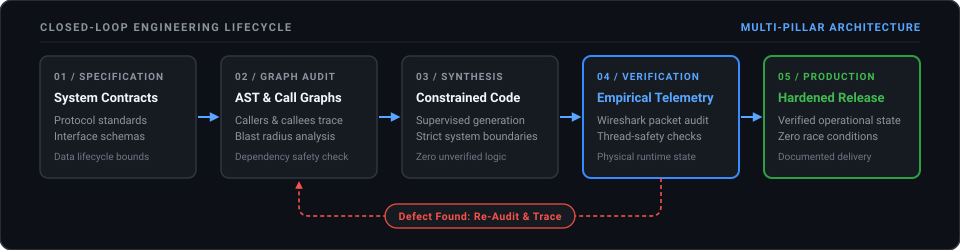

  

# Julz Torralba
**Systems & Network Infrastructure • Full-Stack Software Engineering**

> [!NOTE]
> Focused on system architecture, protocol integrity, and verified execution. Combining foundational systems administration with disciplined AI-assisted engineering to build robust, multi-discipline software.

---

### About Me
I am an Information Technology student specializing in network infrastructure, protocol architecture, and systems security.

My engineering work spans the full spectrum of software and infrastructure: from low-level network communications and concurrent Java backends to client-secured web applications and hardware-integrated desktop systems. 

Rather than focusing on rote syntax memorization, my practice centers on architectural design, protocol compliance, and empirical verification. I actively govern calibrated AI workflows to accelerate polyglot development across Java, Python, JavaScript, and Bash while maintaining strict systems-level standards.

---

### Engineering Workflow

My development lifecycle operates as a closed-loop engineering pipeline, ensuring software is structurally verified against runtime execution and functional requirements before deployment:

  

1. **Architecture & Design**: Define functional requirements, data schemas, and interface boundaries before writing code.
2. **Structural Analysis**: Trace call hierarchies, dependency trees, and refactoring blast radiuses to preserve structural integrity.
3. **Governed Synthesis**: Direct AI code generation under strict architectural rules, eliminating premature guessing.
4. **Empirical Testing**: Validate behavior against runtime execution, diagnostic telemetry, and rigorous edge-case testing.
5. **Hardened Delivery**: Deploy stable, well-documented software that meets all operational criteria.

---

### Special Features Developed Across Projects

#### Network Systems & Protocol Engineering
- **Raw Socket Web Server**: Engineered an HTTP web server from scratch on raw TCP sockets, handling manual HTTP request parsing and response headers (`ITE183`).
- **Packet-Level Protocol Modifiers**: Developed low-level packet interception, custom payload injection, and automated network stress-test bot frameworks (`ProtocolLib`, `PacketEvents`, `Stresstest Bots`).
- **Enterprise Routing Topologies**: Designed multi-subnet architectures with multi-area OSPF, 802.1Q VLAN trunking, NAT/PAT, and ACL perimeter security in Cisco Packet Tracer and GNS3 (`ITN101`-`ITN111`).
- **Deep Packet Telemetry**: Diagnosed TCP handshakes, protocol anomalies, and flow reconstructions using Wireshark.

#### High-Concurrency Server Architecture
- **Folia Multi-Threaded Concurrency**: Engineered server plugins for region-scheduled looper threads, enforcing cross-region thread safety and asynchronous I/O to prevent server deadlocks (`Infinity-Cave-Plugin`).
- **Transactional State Persistence**: Built custom serialization using Persistent Data Containers (PDC) and HikariCP connection pooling for cross-server database synchronization.
- **Autonomous Auto-Patchers**: Developed chunk-load listeners that dynamically scan and repair structure NBT configurations at runtime on their respective regional threads.

#### Client-Side Security & Frontend Systems
- **Zero-DOM Footprint & JIT Hydration**: Engineered web architectures where sensitive markup is absent from initial DOM, bundling data into obfuscated runtime vaults decoded dynamically on state transitions (`Happy Motmot`).
- **Anti-Tampering & DevTools Shields**: Implemented client shields intercepting DevTools shortcuts (`F12`, `Ctrl+U`), context menu locking, and obfuscated hex logic gates.
- **Interactive Multimedia & Physics**: Developed high-performance HTML5 Canvas particle engines (sinusoidal swaying, 3D tumbling physics) and custom Web Audio API controllers.

#### Hardware-Integrated Desktop Applications
- **Thermal Printer Spooling**: Integrated ESC/POS 58mm monospace thermal receipt formatting and silent native printer spooling into standalone Point-of-Sale desktop software (`Tonari-POS`).
- **Multi-Device Local Sync**: Engineered cross-device POS architectures allowing simultaneous desktop and mobile smartphone operation over local Wi-Fi with zero external dependencies.
- **Real-Time Operational Systems**: Built automatic stock deduction engines, Kitchen Display System (KDS) order queues, and automated CSV sales export reporting.

#### Applied Simulation & Ballistic Mathematics
- **2-Pass True-Arc Trajectory Solvers**: Developed long-range ballistic calculation engines modeling 3D bullet arcs, multi-band stepped ballistic coefficients, and dynamic air density (`ATragExtension`).
- **Environmental Drift & Raycasting**: Implemented real-time wind staleness watchers, ASL-to-ASL raycasting with multi-hit geometry filtering, and Coriolis/Eötvös physics modeling across custom terrain.

---

### Tech Stack

#### Networking & Systems

#### Languages & Systems

#### Tooling & Platforms

---

### Repositories & Implementations
All active implementations, network topologies, and systems tools are documented directly in my public repositories. Explore the pinned repositories below to inspect architecture specifications, network configurations, and source code.

---

  Architectural integrity. Empirical verification. Deliberate engineering.

