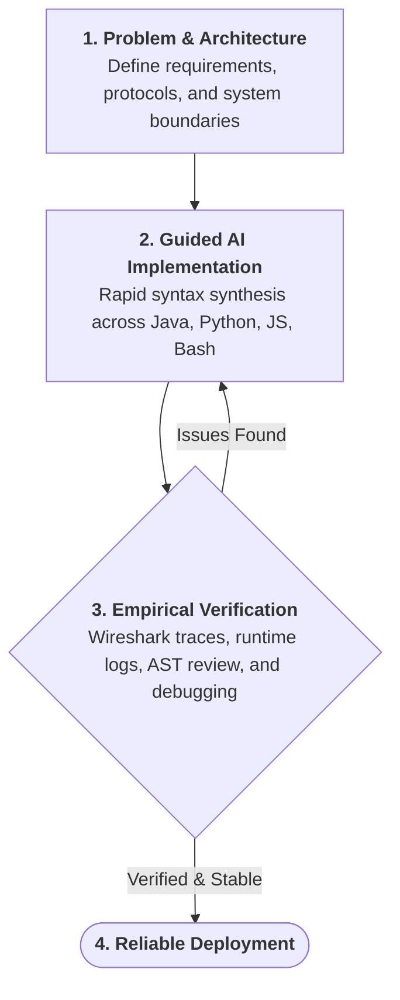

# Julz Torralba
**Network Systems • AI-Assisted Engineering**

---

### About Me
I am an Information Technology student specializing in network infrastructure and systems security.

I design, build, and deploy software across diverse stacks—Java, Python, JavaScript, and Bash—by combining foundational systems principles with disciplined AI-assisted engineering. 

Rather than relying on rote syntax memorization, my focus is on system architecture, protocol design, and knowing how components interact under the hood. I direct calibrated AI workflows to handle syntax synthesis, while I govern the design, logic, and verification standards.

---

### Engineering Standards & AI Governance
Unregulated AI generation often yields fragile, superficial code. I prevent this by enforcing strict engineering governance over my development environment:

- **Enforced Architectural Planning**: My AI is constrained by strict rules—it cannot generate code without a documented implementation plan, complete data-lifecycle tracing, and empirical root-cause analysis.
- **Grounding in Systems & Networking**: With a background in packet telemetry (Wireshark), routing topologies (Cisco Packet Tracer, GNS3), and firewall architecture (pfSense), I evaluate software against real system state, socket lifecycles, and network traffic rather than surface execution.
- **Supervised Delegation**: I treat AI as a high-speed junior developer. It provides rapid scaffolding across languages I am actively exploring, while I inspect code structures, handle edge cases, and maintain strict quality standards.
- **Accelerated Learning**: This disciplined workflow accelerates my technical breadth across computer science, system administration, and disciplines beyond IT without sacrificing structural rigor.

---

### Engineering Workflow

---

### Technical Focus

#### Networking & Systems
- **Packet Telemetry**: Deep packet inspection, traffic troubleshooting, and flow diagnostics in **Wireshark**.
- **Network Topologies**: Subnetting, multi-area OSPF, VLAN trunks, and ACLs in **Cisco Packet Tracer** and **GNS3**.
- **Perimeter Defense**: Stateful traffic filtering, interface routing, and NAT on **pfSense** and **OPNsense**.
- **Operating Systems**: Linux server administration (Debian, Ubuntu), bash scripting, and Windows environment management.

#### Software & Development (AI-Assisted)
- Building backend services, utility tools, and automation in **Java**, **JavaScript/TypeScript**, **Python**, and **Bash**.
- Configuring custom agent instructions, deterministic tool workflows, and prompt context architectures.
- Moving from system architecture to verified implementation with high velocity.

---

### Tech Stack

#### Networking & Infrastructure

#### Languages & Development

#### Tools & Platforms

---

### Repositories
All my active projects, network labs, and tools are published directly in my public repositories. Explore my pinned repositories below to inspect the code, configurations, and topology documentation.

---

  Driven by curiosity. Grounded in systems. Built with care.

