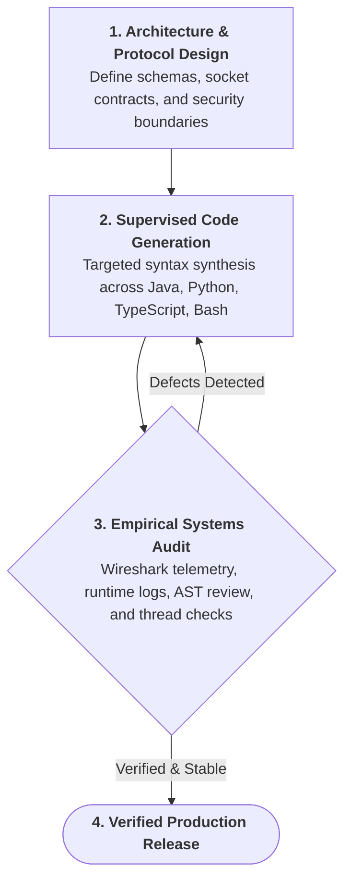

  

# Julz Torralba
**Systems & Network Infrastructure • Full-Stack Software Engineering**

---

### About Me
I am an Information Technology student specializing in network infrastructure, protocol architecture, and systems security.

My engineering work spans the full software and infrastructure stack: from low-level network communications and concurrent Java backends to client-secured web architectures and hardware-integrated desktop systems. 

Rather than focusing on rote syntax memorization, my practice centers on architectural integrity, protocol adherence, and empirical verification. I actively direct calibrated AI workflows to accelerate polyglot development across Java, Python, JavaScript, and Bash while maintaining strict systems-level standards.

---

### Systems Engineering Standards & Governance
Unregulated AI code generation often introduces architectural defects, race conditions, and unmaintainable patterns. To guarantee operational stability, my development environment operates under strict technical controls:

- **Mandatory Architectural Planning**: Implementation never begins without prior schema contracts, data-lifecycle mapping, and formal boundary definition.
- **Empirical Systems & Telemetry Audits**: Software is validated against physical system behavior, socket lifecycles, and network telemetry (Wireshark) rather than surface execution, ensuring integrity across the transport, network, and application layers.
- **Concurrency & State Verification**: In multi-threaded environments (such as region-scheduled server architectures), logic is rigorously audited for race conditions, thread isolation, and memory persistence.
- **Defense-in-Depth & Client Data Hygiene**: Web applications are engineered with strict client-side security standards—including zero-DOM initial footprints, encrypted runtime vaults, and just-in-time DOM hydration.
- **Supervised Code Synthesis**: AI functions strictly as a high-velocity synthesis tool under active human supervision. All generated AST structures, dependency trees, and logic branches undergo human code review and edge-case testing.

---

### Engineering Workflow

---

### Core Technical Focus

#### Network Systems & Telemetry
- **Protocol Dissection & Traffic Analysis**: Deep packet inspection, flow reconstruction, and anomaly diagnostics in **Wireshark**.
- **Network Topologies & Routing**: Subnetting, multi-area OSPF, 802.1Q VLAN trunking, NAT/PAT, and ACL security in **Cisco Packet Tracer** and **GNS3**.
- **Perimeter Defense**: Stateful packet filtering, interface routing, and gateway configurations on **pfSense** and **OPNsense**.
- **Socket & Protocol Programming**: Low-level HTTP servers engineered from raw sockets, network stress-test bot frameworks, and packet-level manipulation tools.

#### Concurrent Systems & Backend Engineering
- **High-Performance Multi-Threading**: Concurrent server architecture engineered for region-scheduled looper threads (Folia), eliminating blocking operations and single-thread bottlenecks.
- **Data Persistence & State Lifecycles**: Custom serialization, persistent data containers (PDC), transactional storage systems, and database bridging (MySQL, PostgreSQL).
- **Systems Administration**: Linux server environments (Debian, Ubuntu), bash automation, and Windows administration.

#### Frontend Engineering & Client-Side Security
- **Defense-in-Depth Web Architecture**: Zero-DOM plaintext exposure, client-side data-at-rest obfuscation, and Just-In-Time (JIT) dynamic DOM hydration.
- **Anti-Tampering & Inspection Shields**: Intercepting DevTools shortcuts (`F12`, `Ctrl+U`, `Ctrl+Shift+I/J/C`), context menu controls, and obfuscated state gates.
- **Interactive Web Systems**: High-performance HTML5 Canvas physics simulations, Web Audio API controllers, and responsive cross-device interfaces.
- **Hardware-Integrated Applications**: Desktop POS software supporting ESC/POS thermal receipt formatting, local hardware drivers, and local persistence.

---

### Tech Stack

#### Networking & Infrastructure

#### Languages & Systems

#### Tooling & Platforms

---

### Repositories & Implementations
All active implementations, network topologies, and systems tools are documented directly in my public repositories. Explore the pinned repositories below to inspect architecture specifications, network configurations, and source code.

---

  Architectural integrity. Empirical verification. Deliberate engineering.

