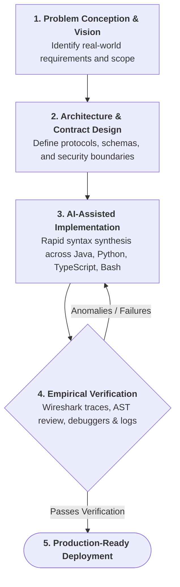

# Julz Torralba
**Systems & Network IT Student • Vision-Driven AI Practitioner • Autodidact**

---

### About Me
I am an Information Technology student majoring in **Network Infrastructure & Systems Security**. 

Rather than walking the traditional path of rote syntax memorization, I position myself as a **vision-driven builder**. I combine a solid foundation in core networking principles with modern **agentic AI orchestration**, using custom-trained AI workflows as a cognitive multiplier to design, code, and deploy systems with speed, scale, and clarity.

---

### Transparent by Design: How I Build & Learn

> *"I am not an encyclopedic programmer who writes hundreds of lines of code blindly without documentation. My true strength is vision, creative architecture, and the ability to direct and refine AI to turn complex ideas into working reality."*

- **Vision Over Syntax Memorization**: Syntax can be referenced or synthesized in seconds; what matters is knowing *what* to build, *why* the architecture matters, and *how* systems connect securely.
- **Training My Tools**: I actively train, instruct, and calibrate my AI systems with strict behavioral rules, domain context, and verification safeguards. I treat AI not as a generic chat prompt, but as a specialized pair engineer tuned to my exact workflows.
- **Continuous Compounding**: Through this continuous feedback loop, my technical intuition deepens every single day. Every codebase, script, and network lab I build elevates my understanding of the underlying craft.
- **Universal Curiosity (Beyond IT)**: I don't confine AI to code or network packets. I treat it as an open-ended intellectual sparring partner to rapidly deconstruct unfamiliar topics, dive into diverse disciplines, and learn anything I set my mind to.

---

### Engineering Approach: Intent, Direction & Verification

1. **Architectural Intent**: I define the problem, boundaries, and expected behavior.
2. **AI-Accelerated Execution**: Tuned AI agents translate that intent into clean code across diverse languages.
3. **Grounded Verification**: Everything is tested against real-world systems, network telemetry, and runtime outputs—ensuring zero unverified logic.

---

### Technical Focus & Competencies

#### Networking & Infrastructure Core
- **Packet Telemetry & Diagnostics**: Deep packet inspection, flow analysis, and protocol troubleshooting in **Wireshark**.
- **Network Simulation & Topology**: Multi-area OSPF, VLAN segmentation, NAT/PAT, and ACL implementation in **Cisco Packet Tracer** and **GNS3**.
- **Perimeter Defense**: Stateful firewall rulesets, traffic filtering, and interface routing on **pfSense** and **OPNsense**.
- **Systems Administration**: Linux server environments (Debian/Ubuntu), bash automation, and Windows administration.

#### Software & Polyglot Execution
- **Polyglot Problem Solving**: Directing reliable implementations in **Java**, **JavaScript/TypeScript**, **Python**, and **Bash**.
- **Agent Orchestration**: Crafting custom instructions, context architectures, and tool-assisted agent workflows.
- **Rapid Prototyping**: Bridging the gap from abstract concept to running, functional software in record time.

---

### Tech Stack & Environments

#### Networking & Systems Infrastructure

#### Software & Polyglot Stack (AI-Augmented Execution)

#### Tooling & Platforms

---

### Repositories & Builds
All my active builds, network configurations, packet analysis studies, and automated tools are documented directly in my public repositories. Feel free to explore my pinned and public projects below to inspect the code, architectures, and lab topologies.

---

  Driven by curiosity. Powered by intent. Engineered with discipline.

